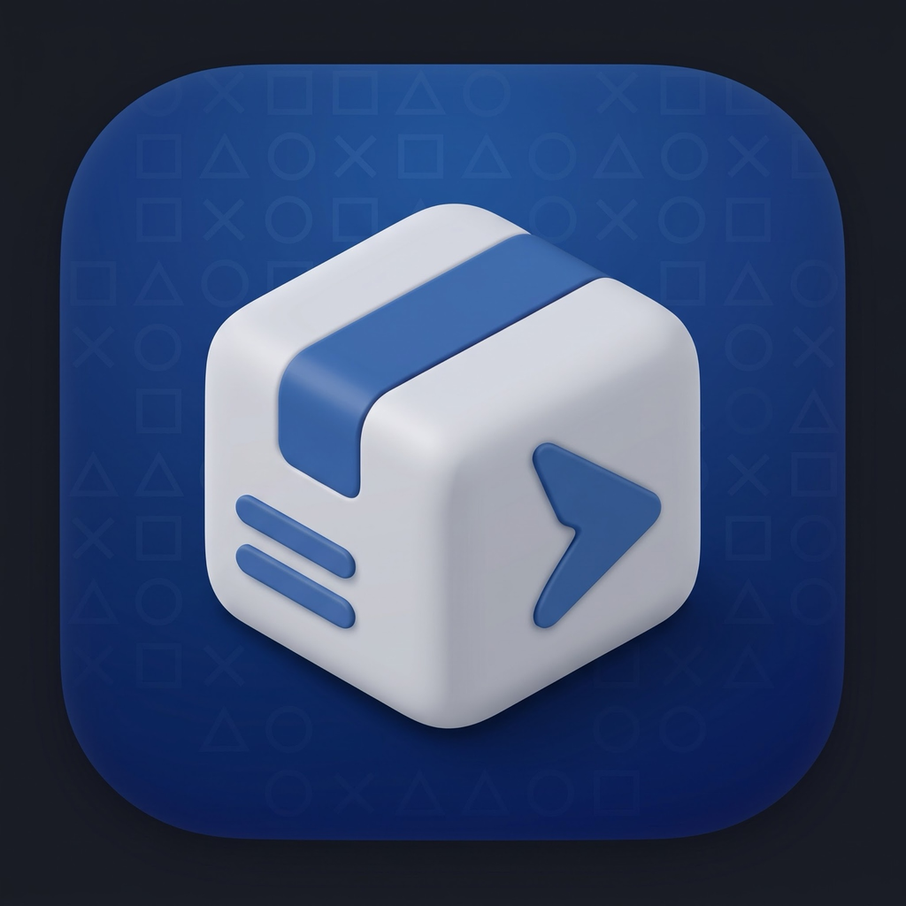
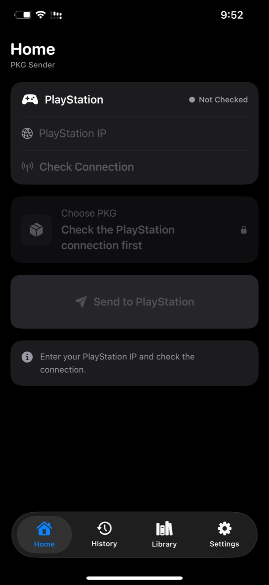
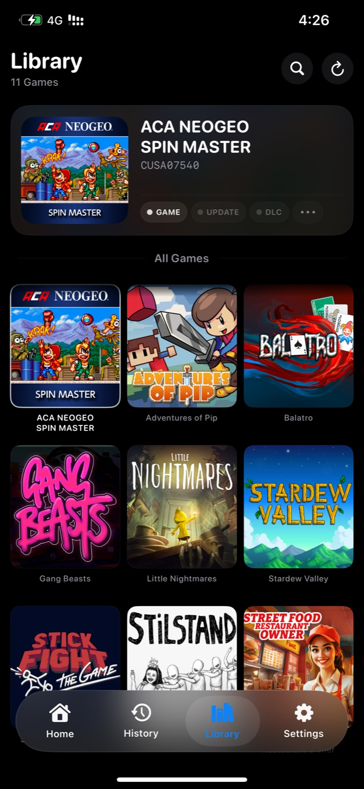
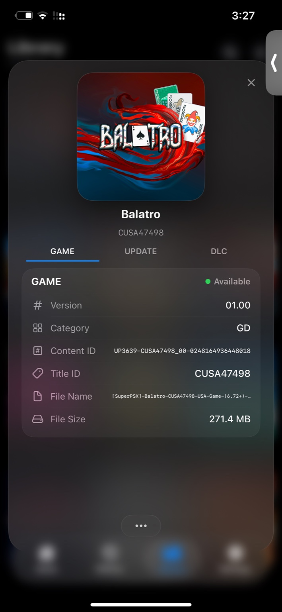
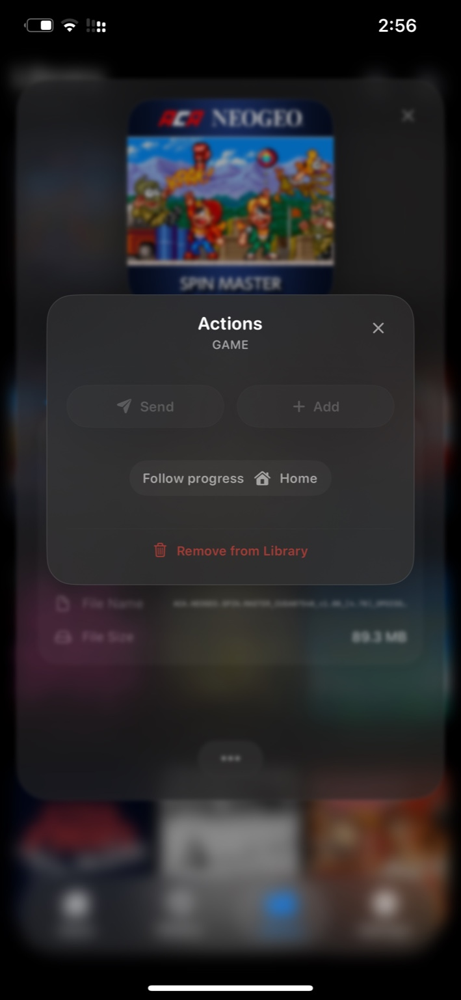
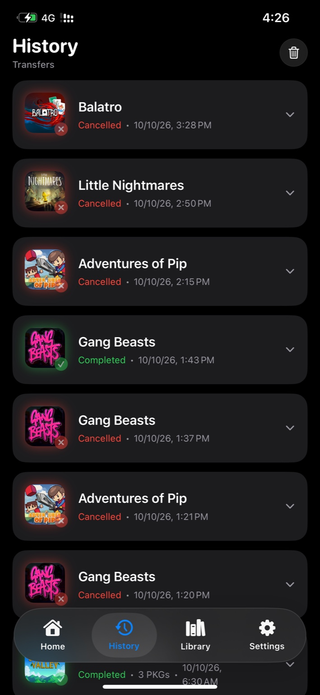
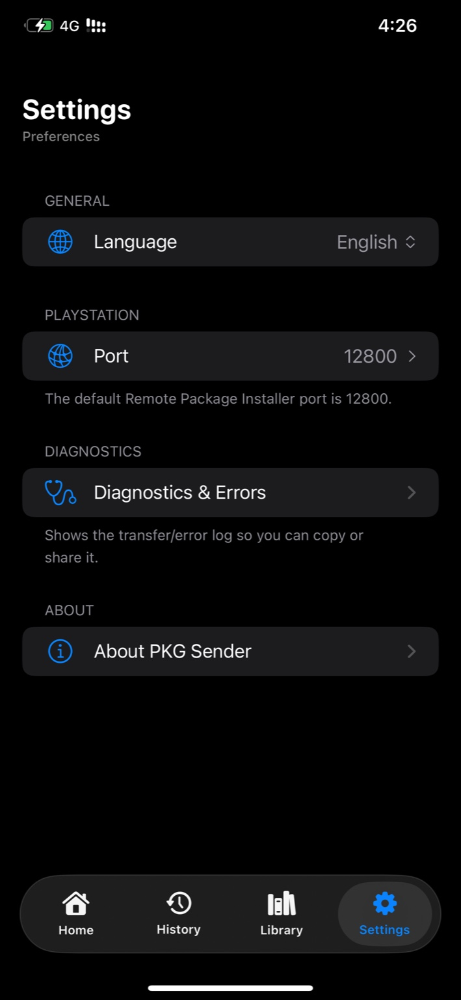
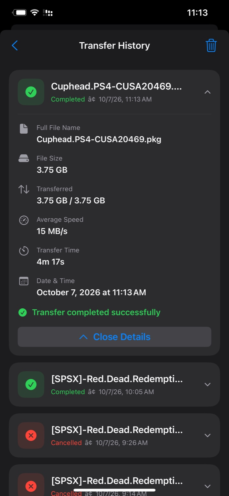

# PKG Sender

### Send PS4 PKG files directly from your iPhone.

A native iOS app for sending **GAME**, **UPDATE**, and **DLC** PKG files to a PlayStation 4 running Remote Package Installer.

**iOS 16+ · Arabic & English · Local network transfer**

[**Download Latest IPA**](../../releases/latest) · [**View Releases**](../../releases)

---

## Screenshots

  
  
  

 

  
  
  

## Features

- Direct PKG transfer from iPhone/iPad to PS4
- GAME, UPDATE, and DLC support
- Built-in PKG library with metadata and artwork
- Transfer queue with live progress, speed, and ETA
- Transfer history with completed/cancelled details
- Local file availability tracking
- Arabic and English interface
- PS4 connection check before sending
- Local network transfer — PKG files are not uploaded to a cloud service
- Designed and tested with large PKG files

## Transfer Performance

Real-device testing was performed on an **iPhone 11 Pro Max**, with both the iPhone and PS4 connected over **Wi-Fi**.

- **Peak observed transfer speed:** up to **19 MB/s**
- **Best observed average transfer speed:** approximately **15 MB/s**
- A completed **3.75 GB** transfer recorded an average of **15 MB/s**

  

Actual performance depends on the phone, console, router, Wi-Fi conditions, and local network setup. A setup using wired LAN for the PS4 may perform better, but **wired-LAN performance has not been tested for this project**, so no wired speed is claimed here.

## Requirements

- iPhone or iPad running **iOS 16 or later**
- A PS4 capable of running **Remote Package Installer**
- iPhone/iPad and PS4 connected to the same local network
- A compatible method for installing the IPA on your device

## Installation

1. Open the [**latest release**](../../releases/latest).
2. Download `PKGSender.ipa` from **Assets**.
3. Install the IPA using TrollStore or another compatible sideloading/signing method.
4. Open **PKG Sender**.

> The release IPA is unsigned. Installation requirements depend on the method and device you use.

## How to Use

1. Launch **Remote Package Installer** on your PS4.
2. Open **PKG Sender** on your iPhone or iPad.
3. Enter your PS4 IP address.
4. Make sure the PS4 and iPhone/iPad are on the same network.
5. Select a `.pkg` file.
6. Review the detected package information.
7. Send it to the PS4 and follow the transfer progress in the app.

Keep PKG Sender active while a transfer is running. iOS may suspend local networking when the app is backgrounded.

## Library

PKG Sender can maintain a local library of detected packages and their metadata. GAME, UPDATE, and DLC packages can be grouped together, while file availability is tracked separately from saved metadata.

## Privacy

PKG Sender works locally. Package metadata, library information, and transfer history are stored on the device, and PKG transfers happen over your local network.

## Build from Source

This repository includes a GitHub Actions workflow that creates an unsigned IPA.

1. Fork or clone the repository.
2. Open **Actions**.
3. Run **Build iOS IPA**.
4. Download the generated IPA artifact when the workflow finishes.

The project uses **SwiftUI**, targets **iOS 16+**, and can be generated with **XcodeGen**.

## AI Development Notice

PKG Sender was developed with the assistance of artificial intelligence. The application's source code was generated and iteratively refined using AI, while project direction, feature decisions, real-device testing, debugging feedback, and final validation were handled by **T2oDna**.

## Notes

- Default Remote Package Installer port: `12800`
- The app serves the selected PKG locally to the console during transfer.
- Network speed depends on the iPhone/iPad, PS4, router, Wi-Fi conditions, and local network.
- PKG Sender is an independent project and is not affiliated with Sony Interactive Entertainment.

## Credits

Created by **T2oDna**.

---

**PKG Sender · Version 1.0**

